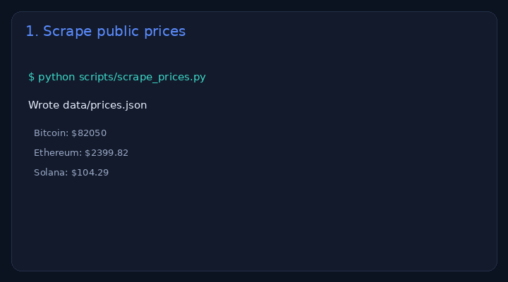

# Live scrape dashboard (auto-updated)

> **For non-technical clients — start here**
>
> **What it does:** A small robot fetches public numbers (here: BTC / ETH / SOL prices) and shows them on a web dashboard.
>
> **Try it in 1 click:** open the [**live demo**](https://cdn.jsdelivr.net/gh/nyyoautomation/nyyo-live-scrape-dashboard@main/index.html) and read the cards + “Last scrape” time.
>
> **Business benefit:** stop checking 5 websites every morning. Get a live board (and optional Telegram/Discord alerts). Setup from **$120**.



**Live demo:** https://cdn.jsdelivr.net/gh/nyyoautomation/nyyo-live-scrape-dashboard@main/index.html  
*(GitHub Pages once enabled: https://nyyoautomation.github.io/nyyo-live-scrape-dashboard/)*  
**Brand:** [Nyyo Automation](https://github.com/nyyoautomation)

[](#)
[](#)
[](#)

---

## What you get

- `scripts/scrape_prices.py` — pulls public prices (CoinGecko, no key)
- `data/prices.json` — last scrape snapshot
- Static dashboard (`index.html`) that renders the JSON

## Refresh the data

```bash
python scripts/scrape_prices.py
# commit data/prices.json to publish an update
```

A scheduled GitHub Action can refresh this automatically (needs workflow + Pages permissions on the token).

## What’s for sale

| | |
|---|---|
| **Product** | Custom monitored scrape + dashboard + optional alert |
| **From** | **$120** setup · retainer **$100–300/mo** |
| **Examples** | Competitor prices · lead lists · stock / availability · job boards |

→ [Packages & contact](https://github.com/nyyoautomation) · [LaborX — Nyyo Automation](https://laborx.com/freelancers/users/id475124)

## Hire me

1. Open an **issue** with: goal · deadline · budget  
2. Or message **[LaborX — Nyyo Automation](https://laborx.com/freelancers/users/id475124)**

Crypto: USDC / SOL / ETH / BTC.

## Limits (honest)

- Demo uses **public** market data for illustration — not financial advice.
- Respect each site’s terms; we don’t sell “bypass anti-bot” as a service.

<details>
<summary>🇫🇷 Français</summary>

**Dashboard alimenté par un scrape.** Ouvrez la [démo live](https://cdn.jsdelivr.net/gh/nyyoautomation/nyyo-live-scrape-dashboard@main/index.html) : les cartes montrent des prix publics mis à jour par un script.  
Bénéfice : plus de copier-coller chaque matin. Prestation à partir de **120 $**.

</details>
